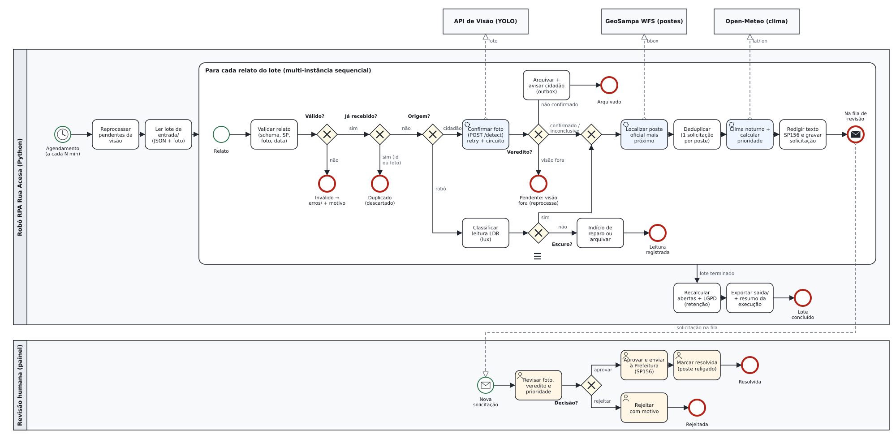
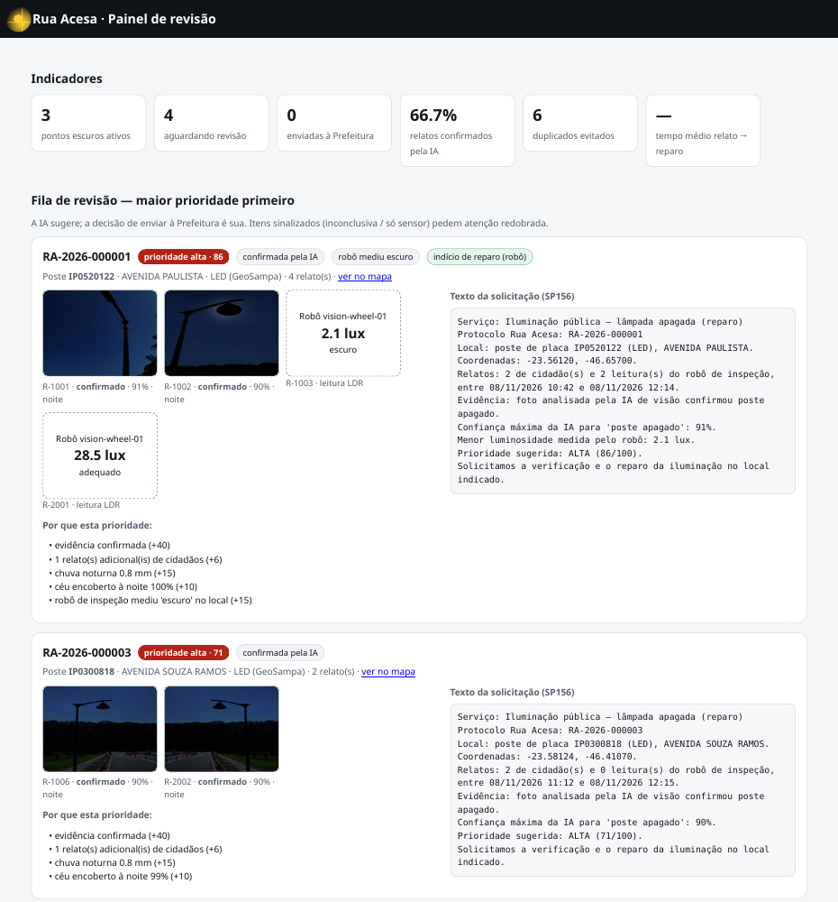

# Rua Acesa — Automação (Robotic Process Automation)

Componente de **automação** do Rua Acesa, produto da Global Solution 2026.2 (CitizenTech · Engenharia de Software 4º ano · FIAP).

Um **robô em Python** cuida da etapa que, sem ele, ficaria com uma pessoa. Ele valida cada relato de poste apagado, pede ao YOLO a confirmação da foto, encontra o poste oficial no cadastro da Prefeitura (GeoSampa), junta relatos repetidos do mesmo poste, prioriza pelo risco (chuva à noite, número de relatos, leitura do robô de inspeção) e redige a solicitação ao SP156. Uma pessoa só **aprova ou rejeita** a solicitação pronta, no painel de revisão.

| Item | Link |
| --- | --- |
| Repositório | [github.com/GabrielDiegues/gs-rpa-2.2026](https://github.com/GabrielDiegues/gs-rpa-2.2026) |
| Vídeo de demonstração (YouTube, não listado, até 3 min) | _a preencher_ |
| Relatório técnico (PDF) | [`docs/relatorio.pdf`](docs/relatorio.pdf) |
| Fluxo BPMN 2.0 | [`docs/fluxo_rpa.bpmn`](docs/fluxo_rpa.bpmn) (abre no [bpmn.io](https://demo.bpmn.io) ou no Camunda Modeler) · [`docs/fluxo_rpa.svg`](docs/fluxo_rpa.svg) |
| PDD (documento do processo) | [`docs/pdd.md`](docs/pdd.md) |
| Componente de visão (integrado) | [github.com/GabrielDiegues/gs-computer-vision-2.2026](https://github.com/GabrielDiegues/gs-computer-vision-2.2026) |

---

## Ficha técnica do MVP (resumo)

| Campo | Descrição |
| --- | --- |
| **Produto** | Rua Acesa |
| **Cidadão e território** | Quem circula a pé à noite em São Paulo: trabalhadores que voltam tarde, estudantes, mulheres e quem espera em ponto de ônibus. |
| **Problema** | Ruas com poste apagado deixam o trajeto noturno inseguro, e o cidadão não sabe como reclamar nem acompanha se o reparo acontece. |
| **Proposta de valor** | O cidadão (ou o robô de inspeção) registra o ponto escuro com foto, a IA confirma e prioriza, e o sistema encaminha a solicitação e mostra no mapa onde a cidade está escura. |
| **Papel do RPA** | Valida o relato, chama o YOLO, deduplica por poste, prioriza, gera a solicitação e registra logs. Implementado em **Python** (a ficha original citava n8n). |
| **ODS** | 11 (cidades seguras), 10 (expõe a periferia com mais pontos escuros) e 9 (infraestrutura monitorada com IA e dados abertos). |

---

## O processo, antes e depois

**Antes (manual).** Um atendente lê cada reclamação, abre a foto, julga se o poste está mesmo apagado, procura o poste no cadastro, confere se já existe chamado aberto, avalia a urgência e redige o pedido. Relatos repetidos viram chamados repetidos. Fotos tiradas de dia viram chamados indevidos.

**Depois (robô).** O robô processa o lote inteiro sozinho e entrega uma **fila priorizada**: cada item já tem foto, veredito da IA, poste oficial, motivos da prioridade e texto pronto. A pessoa decide em segundos, e o robô nunca envia nada sem essa aprovação (IA responsável).



| # | Etapa | Decisão / regra |
| --- | --- | --- |
| 1 | **Validar** o JSON e a foto | Schema estrito, coordenada dentro do município de SP, data não futura nem com mais de 30 dias, foto JPEG/PNG/WebP legível até 10 MB. Se falhar, vai para `erros/` com o motivo. |
| 2 | **Idempotência** | Mesmo `id` ou mesma foto (SHA-256) já recebidos: o relato é registrado como duplicado e não é reprocessado. |
| 3a | **Cidadão**: `POST /detect` no YOLO | `confirmado` segue · `nao_confirmado` é arquivado e o cidadão recebe aviso · `inconclusivo` (ex.: foto diurna) segue sinalizado · visão fora do ar deixa o relato em `pendente_visao`. |
| 3b | **Robô**: leitura do LDR (lux) | O RPA reconfere a classificação pelos limiares (NBR 5101): `escuro` (< 5 lux) vira evidência · `adequado`/`fraco` num poste com chamado aberto vira **indício de reparo**. |
| 4 | **Poste oficial** | Consulta ao vivo no WFS do GeoSampa (`geoportal:iluminacao_publica`, cerca de 663 mil pontos) e escolhe o mais próximo num raio de 40 m. |
| 5 | **Deduplicação** | Uma solicitação aberta por poste; relatos novos reforçam a existente. |
| 6–7 | **Clima + prioridade** | Open-Meteo (chuva e nebulosidade nas horas noturnas) e a pontuação de 0 a 100 da tabela abaixo. |
| 8 | **Solicitação** | Protocolo `RA-AAAA-NNNNNN` e texto para o SP156 (template; LLM opcional). |
| 9 | **Persistir e auditar** | SQLite + log JSONL + exports em `saida/`. |

**Pontuação de prioridade.** A base depende da evidência: confirmada pelo YOLO **40**, só sensor **25**, inconclusiva **20**. Somam-se +6 por relato extra (máx. +30), **+15** se houver chuva noturna, **+10** se o céu estiver encoberto (> 80%) à noite, **+15** se o robô corroborar "escuro" e +1 por dia em aberto (máx. +10). Faixas: **alta ≥ 70**, **média ≥ 45** e **baixa** abaixo de 45. Os motivos de cada pontuação aparecem no painel.

---

## Como rodar

Requisitos: Python 3.11+ (testado no 3.12) e internet (GeoSampa e Open-Meteo são públicos e não pedem chave).

```bash
python3 -m venv .venv && source .venv/bin/activate
pip install -r requirements.txt      # instala também o pacote src/rua_acesa_rpa
cp .env.example .env                 # opcional: todos os valores têm padrão
```

### 1. Subir a API de visão (outro repositório)

```bash
# no repositório gs-computer-vision-2.2026
uvicorn app.main:app --host 127.0.0.1 --port 8000
```

Sem ela o robô continua funcionando: os relatos de cidadão ficam `pendente_visao` e são reprocessados depois.

### 2. Dados de apoio e lote de demonstração

```bash
python scripts/baixar_postes_geosampa.py   # recorte real do cadastro de postes (plano B offline)
python scripts/gerar_lote_demo.py          # 14 relatos em entrada/ cobrindo todos os cenários
```

### 3. Executar o robô

```bash
python -m rua_acesa_rpa processar               # reprocessa pendentes + processa o lote
python -m rua_acesa_rpa agendar --intervalo 5   # modo contínuo (a cada 5 min)
python -m rua_acesa_rpa reprocessar-pendentes   # só os que aguardam a visão
python -m rua_acesa_rpa status                  # indicadores + últimas execuções
```

Saída real da primeira execução: [`assets/terminal/01_lote1_processar.txt`](assets/terminal/01_lote1_processar.txt).

```
12:17:39 INFO    visao         [R-1001] veredito=confirmado cena=noite conf_apagado=0.91 (25 ms) — 1 poste(s) apagado(s) com confiança ≥ 0.5
12:17:39 INFO    poste         [R-1001] poste IP0520122 (AVENIDA PAULISTA, LED) a 3.6 m [geosampa_wfs]
12:17:40 INFO    solicitacao   [R-1001] nova solicitação RA-2026-000001 — prioridade media (65) com 1 relato(s)
12:17:40 INFO    solicitacao   [R-1002] agrupado na solicitação existente (deduplicado) RA-2026-000001 — prioridade alta (71) com 2 relato(s)
12:17:40 WARNING validacao     R-1012.json rejeitado: coordenada (-22.907, -43.173) fora do município de São Paulo
12:17:40 INFO    duplicado     [R-1013] mesma foto do relato R-1001
12:17:40 INFO    fim           concluida: lidos=14 sucessos=10 invalidos=4 duplicados=1 confirmados=3 ...
```

Segunda noite, com a visão desligada de propósito: `python scripts/gerar_lote_demo.py --lote 2 && python -m rua_acesa_rpa processar`. Resultado em [`02_lote2_visao_fora.txt`](assets/terminal/02_lote2_visao_fora.txt) e [`03_reprocessar_pendentes.txt`](assets/terminal/03_reprocessar_pendentes.txt).

### 4. Painel de revisão humana

```bash
python -m rua_acesa_rpa painel     # http://localhost:8001
```



Fila priorizada com fotos, veredito, leituras do robô, motivos da prioridade e texto pronto. Ações: aprovar e enviar · rejeitar (motivo obrigatório) · marcar como resolvida. Também tem mapa dos pontos escuros, histórico de execuções e trilha de auditoria. API JSON: `GET /api/fila`, `/api/pontos`, `/api/indicadores`, `/api/execucoes`, `POST /api/solicitacoes/{id}/{aprovar|rejeitar|resolver}`.

### 5. Testes

```bash
pytest                 # 75 testes: sucesso, decisão e falha (APIs externas simuladas)
pytest -m integracao   # 3 testes contra a API de visão REAL (precisa dela no ar)
```

Detalhes e saída em [`tests/README.md`](tests/README.md).

---

## Exceções e resiliência

| Falha prevista | O que o robô faz |
| --- | --- |
| API de visão fora do ar / lenta / HTTP 5xx | 3 tentativas com backoff exponencial (1 s, 2 s). Depois, o relato fica `pendente_visao` e é **reprocessado automaticamente** na próxima execução. Um circuit breaker para de chamar a visão no lote após falhas seguidas. |
| Visão recusa a foto (413/415/422) | Não repete. O relato fica `rejeitado_visao`, com o motivo. |
| Resposta da visão fora do contrato | Validação Pydantic. O relato fica pendente e o erro vai para o log. |
| GeoSampa fora do ar | Usa o cache local de postes e, se preciso, o recorte `dados/postes_geosampa.csv`. Um aviso por lote. |
| Open-Meteo fora do ar | Calcula a prioridade sem o fator clima e explica isso nos motivos. |
| JSON inválido, campo extra, foto ausente/corrompida/grande, fora de SP, data futura | O relato vai para `erros/<execução>/` com `.erro.txt` explicando o motivo. |
| Relato ou foto repetidos | `processados/<execução>/duplicados/` com nota. |
| Erro inesperado num relato | Isolado com try/except: esse item vai para `erros/` e o lote continua. A execução termina como `concluida_com_falhas`. |
| Lote grande | Limite `MAX_LOTE`; o restante fica para a próxima execução. |

Nada é silencioso. Cada ocorrência vira linha no log JSONL, evento no banco (visível no painel) e contador no resumo da execução.

## Logs e auditoria

- `logs/rpa_AAAA-MM-DD.jsonl`: uma linha por passo (`ts`, `run_id`, `nivel`, `etapa`, `relato_id`, `solicitacao_id`, `mensagem`). Amostra real em [`logs/amostras/`](logs/amostras/).
- Tabela `execucoes`: início, fim, status e resumo (lidos, sucessos, inválidos, duplicados, pendentes, falhas).
- Tabela `eventos`: a mesma trilha, consultável pelo painel. Decisões humanas registram quem decidiu, quando e por quê.
- Sem dados sensíveis: e-mails e telefones são mascarados por filtro, e as coordenadas vão para o log arredondadas (cerca de 100 m).

## Integração com o MVP

| Com quem | Como | Contrato |
| --- | --- | --- |
| **Visão (YOLO)** | HTTP `POST /detect` e `GET /health` | `ResultadoVisao` em `modelos.py` espelha `app/schemas.py` da visão |
| **API central / app do cidadão** | deposita relatos em `entrada/` | formato em [`docs/contrato_dados.md`](docs/contrato_dados.md) |
| **Robô de inspeção (Maker Lab)** | mesmo JSON, com `origem: "robo"` e `leitura.luminosidade_lux` | idem |
| **Mapa / painel** | `saida/pontos_escuros.geojson`, `GET /api/pontos` | GeoJSON |
| **Big Data (Airflow → Databricks)** | `saida/solicitacoes.csv`, `saida/relatos.csv` (pseudonimizado) | colunas no contrato |
| **Indicadores / BI** | `saida/indicadores.json`, `GET /api/indicadores` | tempo médio relato→reparo, pontos ativos, % confirmados, duplicados evitados |
| **API central (notificações)** | tabela `notificacoes` (outbox, com hash do contato) | a API central envia; o RPA nunca guarda o contato em claro |

## Segurança e LGPD

- **Minimização:** o único dado pessoal é o contato opcional. Ele é guardado como hash HMAC-SHA256 com salt fora do código (`SALT_LGPD` ou `dados/.salt`) e numa versão mascarada (`m***@example.com`).
- A foto é **regravada sem EXIF/GPS** antes de ser guardada e é apagada após `RETENCAO_FOTOS_DIAS` quando o caso é encerrado.
- Credenciais e URLs vêm do `.env`, que fica fora do git (`.env.example` documenta tudo). Nenhuma chave é necessária para as APIs públicas.
- A API do painel não expõe hash nem máscara de contato. Fotos são servidas só pelo id, com proteção contra *path traversal*.
- **IA responsável:** o YOLO e a regra de prioridade *sugerem*. O envio à Prefeitura exige aprovação humana registrada.

## Estrutura

```
src/rua_acesa_rpa/   código do robô (pipeline, integrações, regras, LGPD, auditoria) e painel/
scripts/             GeoSampa, lote de demonstração, BPMN, relatório PDF
tests/               75 testes + integração real + evidências (tests/evidencias/)
docs/                BPMN (.bpmn/.svg), PDD, contrato de dados, roteiro do vídeo, relatório (md/pdf)
assets/              prints do painel, saídas do terminal, fotos de amostra (CC BY 4.0)
logs/amostras/       amostra real de log JSONL (sem dados sensíveis)
dados/               recorte GeoSampa versionado; banco e fotos ficam fora do git
entrada/ processados/ erros/ saida/   ciclo de vida dos relatos
```

## Equipe

| Nome | RM |
| --- | --- |
| Gabriel Diegues Figueiredo Rocha | 550788 |
| Pedro Henrique Palladino | 551180 |
| Pedro Henrique Pontes | 98036 |
| Raí Gumieri dos Santos | 98287 |

## Fontes e licenças

- Postes: GeoSampa / SMUL-ILUME, camada `geoportal:iluminacao_publica` (dados abertos da Prefeitura de São Paulo).
- Clima: [Open-Meteo](https://open-meteo.com) (CC BY 4.0).
- Fotos de amostra: datasets públicos do Roboflow Universe (CC BY 4.0), os mesmos do componente de visão. Os contatos do lote de demonstração são fictícios (`example.com`).
