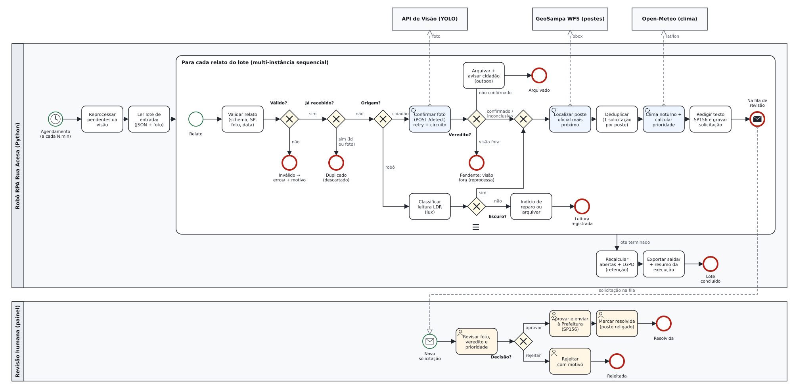
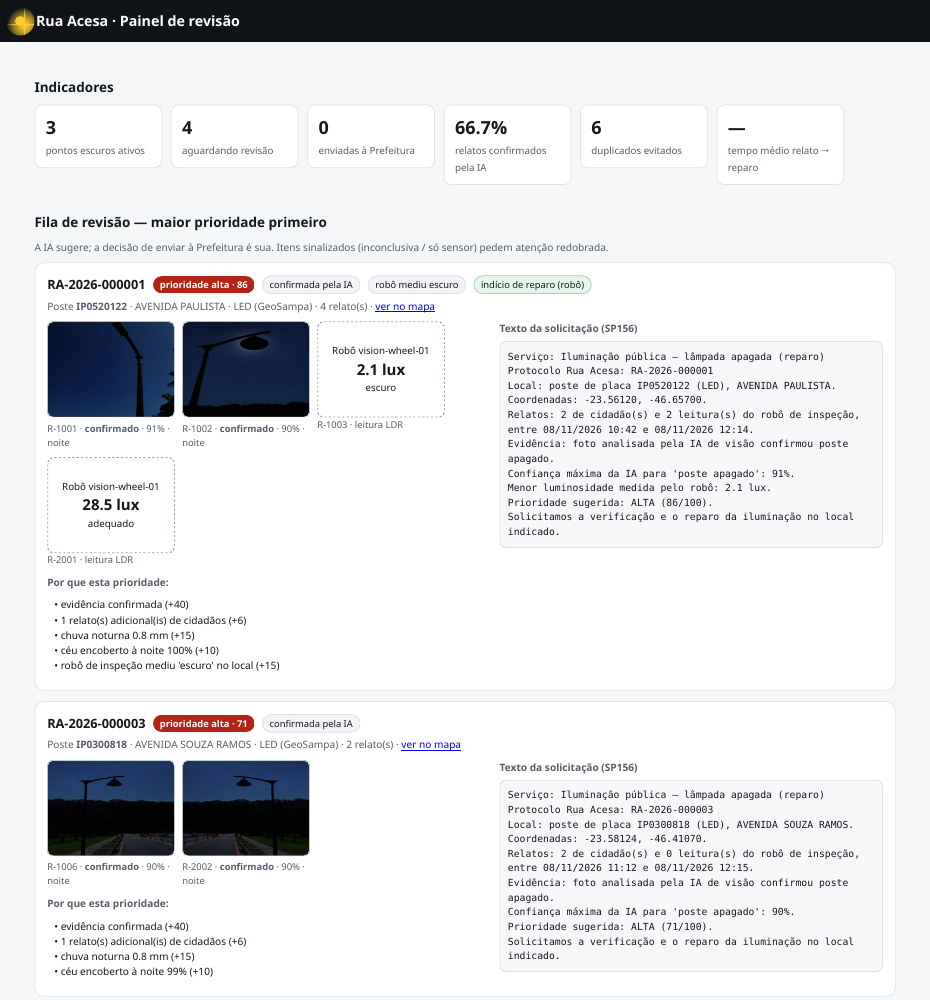
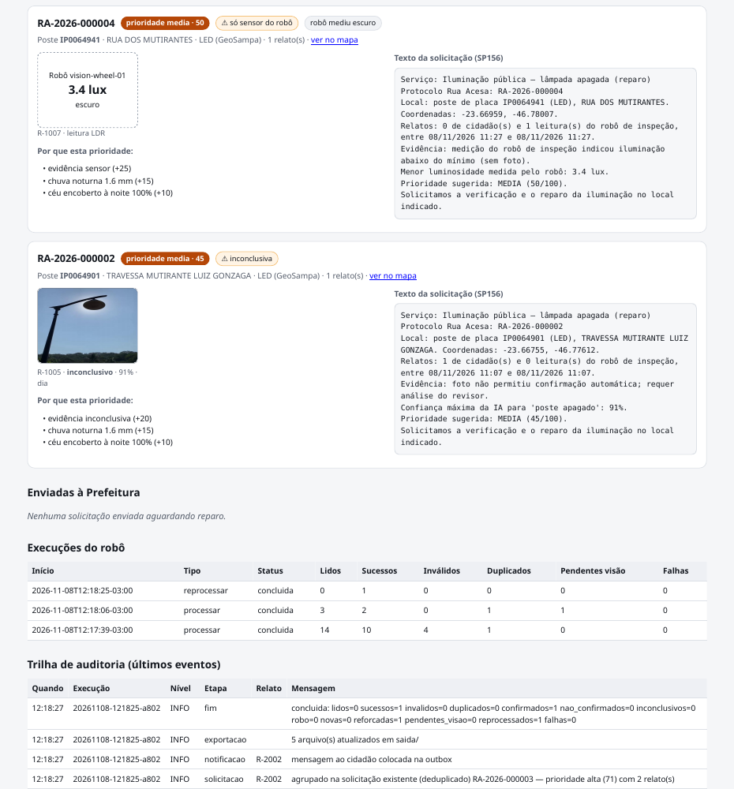

# Rua Acesa — Automação Inteligente de Relatos de Iluminação Pública

**Robotic Process Automation · Global Solution 2026.2 · CitizenTech · Engenharia de Software 4º ano · FIAP**
Atividade: *Do Processo Manual à Automação Inteligente* · Professores: Bruno Diniz e Cibele Ribeiro

## 1. Integrantes

| Nome completo | RM |
| --- | --- |
| Gabriel Diegues Figueiredo Rocha | 550788 |
| Pedro Henrique Palladino | 551180 |
| Pedro Henrique Pontes | 98036 |
| Raí Gumieri dos Santos | 98287 |

## 2. A CitizenTech e o problema resolvido

O **Rua Acesa** é uma plataforma de fiscalização cidadã da iluminação pública de São Paulo. Atende quem circula a pé à noite: trabalhadores que voltam tarde, estudantes, mulheres e quem espera em ponto de ônibus. Ruas com poste apagado deixam esse trajeto inseguro, e o cidadão não sabe como reclamar nem acompanha se o reparo acontece. O cidadão (ou o robô de inspeção com sensor de luz) registra o ponto escuro com foto. A IA de visão confirma, o sistema prioriza e encaminha a solicitação, e o mapa mostra onde a cidade está escura.

**O problema operacional que este componente resolve.** Entre o relato e o chamado na Prefeitura existe um trabalho manual repetitivo. Alguém precisa abrir cada foto, julgar se o poste está mesmo apagado (fotos diurnas enganam), achar o poste no cadastro, conferir se já existe chamado aberto, decidir a urgência e redigir o pedido. Sem automação, cada relato custa minutos de atenção humana, relatos do mesmo poste viram chamados duplicados e a urgência é decidida por intuição.

## 3. Objetivo da automação e benefício para o cidadão

**Objetivo.** Um robô em Python transforma cada lote de relatos brutos em solicitações **confirmadas, deduplicadas, priorizadas e redigidas**. A intervenção humana fica restrita à aprovação final, e toda a operação deixa trilha de auditoria.

**Benefícios.**
- **Para o cidadão:** resposta mais rápida e retorno sobre o próprio relato (aviso de confirmação, pedido de nova foto à noite, aviso de envio e de reparo). Os pontos mais perigosos, com noite chuvosa, muitos relatos e medição de escuro pelo robô, sobem na fila.
- **Para a operação:** um poste vira uma única solicitação, falsos positivos são barrados pela IA, cada prioridade vem explicada e o tempo do revisor cai para segundos por item.
- **Para a gestão pública:** indicadores como tempo médio entre relato e reparo, pontos escuros ativos, % de relatos confirmados pela IA e duplicados evitados. Os exports alimentam o mapa e o pipeline de dados (ODS 11, 10 e 9).

## 4. Descrição do processo e desenho do fluxo

**AS-IS (manual):** ler reclamação → abrir foto → julgar → procurar poste no cadastro → procurar chamado aberto → decidir urgência → redigir → abrir chamado.

**TO-BE (robô):** o robô roda agendado (padrão a cada 5 min) ou sob demanda. Primeiro reprocessa os relatos que aguardavam a visão. Depois lê o lote de `entrada/` e, **para cada relato** (estrutura de repetição), valida, verifica duplicidade, decide pela origem (foto do cidadão → YOLO; leitura do robô → limiares de lux), localiza o poste oficial no GeoSampa, deduplica, consulta o clima, calcula a prioridade e redige a solicitação. No fim do lote, recalcula as solicitações abertas, aplica a retenção de fotos (LGPD), exporta os arquivos de integração e grava o resumo da execução. A solicitação chega ao painel, onde uma pessoa aprova (e envia ao SP156), rejeita com motivo ou, depois, marca como resolvida.

O desenho em BPMN 2.0 (próxima página) foi gerado por código (`scripts/gerar_bpmn.py`) em dois formatos. O `docs/fluxo_rpa.bpmn` é editável no bpmn.io ou no Camunda Modeler; o `docs/fluxo_rpa.svg` está reproduzido abaixo. O processo detalhado passo a passo, com exceções por etapa, está no PDD (`docs/pdd.md`).

<div class="paisagem"><em class="legenda">Figura 1 — Colaboração BPMN: robô RPA (com subprocesso multi-instância sequencial por relato), painel de revisão humana e os serviços externos (visão, GeoSampa, Open-Meteo) ligados por fluxos de mensagem.</em></div>

## 5. Tecnologias utilizadas e justificativa

| Tecnologia | Uso | Por quê |
| --- | --- | --- |
| **Python 3.12** | robô completo (`src/rua_acesa_rpa`) | mesma linguagem dos componentes de visão e dados; versionável, testável e sem licença |
| `requests` | clientes HTTP (visão, GeoSampa, Open-Meteo, LLM opcional) | simples, com timeout explícito; retry e circuit breaker implementados no próprio cliente |
| `pydantic` | contrato de entrada e da resposta da visão | rejeita campos desconhecidos e tipos errados com mensagem clara |
| `sqlite3` (stdlib) | estado: relatos, solicitações, execuções, eventos, outbox, cache de postes | sem servidor, transacional (WAL); fácil de migrar para Postgres |
| `Pillow` | validação de imagem e remoção de EXIF/GPS | LGPD by design |
| **FastAPI + Jinja2** | painel de revisão humana e API JSON | mesma stack da API de visão; o painel serve também de tela do MVP |
| **GeoSampa WFS** | cadastro oficial de cerca de 663 mil pontos de iluminação | dado aberto e real; consulta só a vizinhança do relato (bbox) |
| **Open-Meteo** | chuva e nebulosidade nas horas noturnas | sem chave, gratuito |
| `pytest` | 75 testes + 3 de integração real | cenários de sucesso, decisão e falha reproduzíveis |

Python foi escolhido no lugar de n8n ou UiPath porque o fluxo tem regras de negócio ricas (prioridade, deduplicação geográfica, idempotência), precisa de testes automatizados e roda no mesmo container/pipeline DevSecOps dos outros componentes.

## 6. Regras de negócio, decisões e processamento

**Decisões (condicionais) por relato:**

| Ponto de decisão | Condição | Resultado |
| --- | --- | --- |
| Válido? | schema, coordenada no município de SP, data (não futura, ≤ 30 dias), foto legível ≤ 10 MB | não → `erros/` com motivo |
| Já recebido? | mesmo `id` ou mesmo SHA-256 da foto | sim → duplicado (não reprocessa) |
| Origem? | `cidadao` / `robo` | visão / limiares LDR |
| Veredito da visão | `confirmado` / `nao_confirmado` / `inconclusivo` / indisponível | segue / arquiva + avisa / segue sinalizado (+ pede foto noturna se `cena=dia`) / `pendente_visao` |
| Escuro? (robô) | lux < 5 escuro; < 15 fraco; senão adequado (NBR 5101) | escuro → evidência; adequado após relato → **indício de reparo** |
| Já existe solicitação aberta no poste? | mesma placa do GeoSampa (sem poste: até 30 m) | sim → agrupa (deduplica); não → nova solicitação |

**Prioridade (0–100).** A base depende da evidência: confirmada **40**, só sensor **25**, inconclusiva **20**. Somam-se +6 por relato extra de cidadão (máx. +30), **+15** se chover no período noturno (≥ 0,2 mm numa hora noturna da janela −6 h/+12 h), **+10** com céu encoberto (> 80%) à noite, **+15** se o robô corroborar "escuro" e +1 por dia em aberto (máx. +10). Faixas: **alta ≥ 70**, **média ≥ 45** e baixa abaixo disso. Cada ponto vira um "motivo" exibido ao revisor.

**Repetição:** o lote é uma coleção percorrida item a item (`for arq in arquivos`), assim como os pendentes no reprocessamento e as solicitações abertas no recálculo de fim de lote.

**Exemplo real (lote de demonstração):** os relatos R-1001 e R-1002 (fotos noturnas) caíram no poste **IP0520122 — Av. Paulista**, a 3,6 m e 3,7 m, e viraram uma única solicitação. O robô mediu 2,1 lux no local. A prioridade foi 40 + 6 (2º relato) + 15 (chuva noturna real de 0,8 mm) + 10 (100% de nuvens) + 15 (robô) = **86, alta**.

## 7. Tratamento de exceções e recuperação

| Falha | Tratamento |
| --- | --- |
| Visão fora do ar, timeout, HTTP 5xx | 3 tentativas, backoff exponencial (1 s, 2 s). Esgotadas, o relato fica `pendente_visao` e é reprocessado automaticamente na execução seguinte. **Circuit breaker:** após falhas seguidas (ou `/health` sem resposta), o lote para de chamar a visão. |
| Visão recusa a foto (413/415/422) / resposta fora do contrato | não repete; `rejeitado_visao` / pendente + log ERROR |
| GeoSampa fora | cache local de postes → recorte versionado `dados/postes_geosampa.csv` (1.333 postes de 3 regiões) |
| Open-Meteo fora | 2 tentativas; depois, prioridade sem o fator clima, explicado nos motivos |
| Arquivo inválido / foto ausente, corrompida ou grande / fora de SP / data inválida / campo extra | `erros/<execução>/<arquivo>` + `.erro.txt` com o motivo; a foto vai junto |
| Duplicados | `processados/<execução>/duplicados/` + nota |
| Erro inesperado num item | isolado: o item vai para `erros/`, o registro parcial é desfeito (para o reenvio ser aceito) e o lote continua; a execução termina `concluida_com_falhas` |
| Lote muito grande | `MAX_LOTE`; o restante fica para a próxima execução |

Evidência real: no lote 2, com a API de visão desligada de propósito, o log mostra `tentativa 1 falhou: sem conexão…; nova tentativa em 1.0s`, depois `tentativa 2…`, e por fim `relato fica pendente para a próxima execução`. Com a visão religada, `reprocessar-pendentes` confirmou o relato (90%) e o agrupou na solicitação RA-2026-000003, que passou de 65 para **71 (alta)**.

## 8. Logs e evidências de auditoria

Cada passo gera, ao mesmo tempo, uma linha em `logs/rpa_AAAA-MM-DD.jsonl`, um evento na tabela `eventos` (visível no painel) e uma linha no terminal. Campos: `ts`, `run_id`, `nivel`, `etapa`, `relato_id`, `solicitacao_id` e `mensagem`. A tabela `execucoes` guarda início, fim, status e o resumo (lidos, sucessos, inválidos, duplicados, confirmados, pendentes, falhas). Decisões humanas registram quem decidiu, quando e o motivo.

```
{"ts": "2026-11-08T12:18:06-03:00", "run_id": "20261108-121806-…", "nivel": "WARN", "etapa": "visao",
 "relato_id": "R-2002", "mensagem": "visão indisponível (sem conexão com http://localhost:8000);
 relato fica pendente para a próxima execução"}
```

Resumo de execução (lote 1): `lidos=14 sucessos=10 invalidos=4 duplicados=1 confirmados=3 nao_confirmados=1 inconclusivos=1 robo=4 novas=4 reforcadas=2 pendentes_visao=0 falhas=0`.

**Sem dados sensíveis:** as mensagens passam por um filtro que mascara e-mails e telefones, e as coordenadas entram no log arredondadas para cerca de 100 m. Uma busca pelos contatos do lote de demonstração em logs, exports e saídas do terminal retornou zero ocorrências. As amostras estão em `logs/amostras/` e `assets/terminal/`.

## 9. Integração com o MVP

| Componente | Integração | Evidência |
| --- | --- | --- |
| **Visão (YOLO, outro repositório)** | HTTP real `POST /detect` e `GET /health`; resposta validada contra o mesmo contrato (`ResultadoVisao` ↔ `app/schemas.py`) | logs `veredito=confirmado cena=noite conf_apagado=0.91 (25 ms)`; 3 testes de integração real passando |
| **Robô de inspeção (Maker Lab)** | mesmo JSON de relato, com `origem: robo` e `leitura.luminosidade_lux` | R-1003 (2,1 lux) corroborou RA-2026-000001; R-2001 (28,5 lux) gerou "indício de reparo" |
| **Mapa / painel** | `saida/pontos_escuros.geojson` e `GET /api/pontos` | mapa Leaflet do painel |
| **Big Data (Airflow → Databricks)** | `saida/solicitacoes.csv` (fato) e `saida/relatos.csv` (pseudonimizado, com `contato_hash`) | contrato em `docs/contrato_dados.md` |
| **BI / pitch** | `saida/indicadores.json` e `GET /api/indicadores` | tempo médio relato → reparo, % confirmados, duplicados evitados |
| **API central** | relatos depositados em `entrada/`; notificações numa outbox com o hash do contato | tabela `notificacoes` |

<div class="fig"><em class="legenda">Figura 2 — Painel de revisão (localhost:8001): indicadores e fila priorizada com fotos, veredito da IA, leituras do robô, motivos da prioridade e texto pronto para o SP156.</em></div>

<div class="fig"><em class="legenda">Figura 3 — Itens sinalizados ("só sensor do robô" e "inconclusiva"), histórico de execuções e trilha de auditoria.</em></div>

## 10. Testes realizados (sucesso, decisão e falha)

Suíte `pytest` com **75 testes, todos passando** (~1 s, sem rede). As APIs externas são simuladas por dublês que seguem os contratos reais. Há ainda **3 testes de integração com a API de visão real**, também passando. A saída completa está em `tests/evidencias/pytest_saida.txt` e o mapa de cenários em `tests/README.md`.

| Tipo | Exemplos |
| --- | --- |
| **Sucesso** | lote misto de ponta a ponta (estados, deduplicação, protocolo, arquivos movidos, exports, outbox); vereditos reais da visão; aprovação no painel |
| **Decisão** | tabela de prioridade e faixas; limiares do LDR; indício de reparo; idempotência por id e por foto; deduplicação com e sem poste; rejeição exige motivo; transição inválida → 409 |
| **Falha** | retry com backoff; circuit breaker; 5xx repetido × 415 não repetido; visão fora → pendente → reprocessado; GeoSampa e Open-Meteo fora; 14 casos de validação; falha inesperada isolada no item; limite de lote |

Os testes encontraram um defeito real durante o desenvolvimento: o estado do circuit breaker sobrevivia entre execuções do mesmo processo (modo `agendar`), e os pendentes nunca eram reprocessados. A correção é reabrir o circuito ("meio-aberto") no início de cada execução, e hoje há um teste cobrindo esse caso.

Além dos testes automatizados, o fluxo foi executado de ponta a ponta com os **serviços reais**: visão YOLO local, GeoSampa WFS e Open-Meteo. As saídas estão em `assets/terminal/`.

## 11. Considerações de segurança e LGPD

- **Minimização:** o único dado pessoal é o contato opcional. Ele é guardado apenas como hash HMAC-SHA256 (salt fora do código, em `SALT_LGPD` ou `dados/.salt` com permissão 600) e numa versão mascarada (`m***@example.com`). O schema rejeita campos não previstos (por exemplo, um CPF enviado por engano).
- **Foto:** regravada sem EXIF/GPS antes de ser armazenada e apagada após `RETENCAO_FOTOS_DIAS` quando o caso é encerrado. Os exports nunca levam a foto.
- **Pseudonimização para dados:** `relatos.csv` leva só `contato_hash`, que permite contar cidadãos únicos sem identificá-los, e coordenadas com 4 casas.
- **Logs:** filtro de e-mail/telefone e coordenadas arredondadas.
- **Segredos:** `.env` fora do git e `.env.example` documentado; as APIs usadas são públicas e não exigem chave.
- **Painel:** a API não expõe hash nem máscara; a rota de fotos tem proteção contra *path traversal*; transições de estado são validadas. A autenticação dos revisores fica na camada de produção (DevSecOps).
- **IA responsável:** o YOLO e a regra de prioridade sugerem e explicam. O envio à Prefeitura exige aprovação humana registrada, e a rejeição exige motivo.

## 12. Links

| Item | Link |
| --- | --- |
| Repositório GitHub (este componente) | https://github.com/GabrielDiegues/gs-rpa-2.2026 |
| Vídeo demonstrativo (YouTube, não listado) | _a preencher_ |
| Componente de visão integrado | https://github.com/GabrielDiegues/gs-computer-vision-2.2026 |

**Conclusão.** O robô substitui uma triagem manual de vários minutos por relato por um fluxo automático, idempotente e auditável. Ele integra três serviços reais (YOLO, GeoSampa e Open-Meteo) e degrada com elegância quando qualquer um deles falha. A pessoa revisora decide com foto, veredito, poste oficial, motivos e texto já na tela, e nenhum relato se perde ou é duplicado. As próximas evoluções previstas são integrar a outbox ao canal de notificação da API central, ligar o hook de LLM ao componente de GenAI e cruzar `poste_placa` com o histórico do SP156 para medir a linha de base do tempo de reparo.
